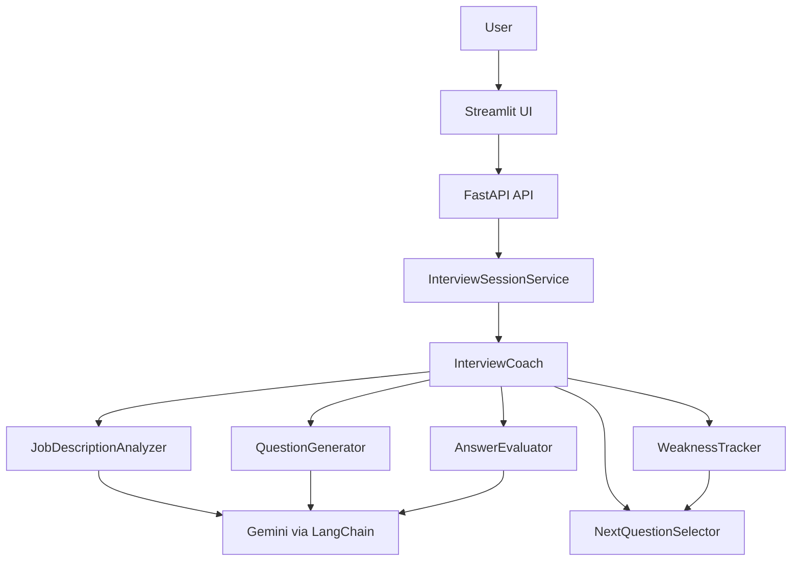

# Adaptive AI Interview Coach

An adaptive AI/ML interview-practice application. It turns a job description into a role-specific interview, evaluates one answer at a time, records topic-level performance, and deliberately prioritizes follow-up questions in weaker areas.

## Why it exists

Static question lists cannot react when a candidate understands Python well but struggles with LLM evaluation. This project makes that feedback loop explicit: each score updates the weak-topic tracker, and the next question is selected from the updated state.

## Features

- Job-description analysis with LangChain structured outputs
- Practical Easy, Medium, and Hard technical questions
- Structured answer feedback: score, strengths, missing concepts, unclear points, and revision areas
- Topic-level weakness tracking and adaptive next-question selection
- Exact-duplicate question protection and bounded interview sessions
- FastAPI API with request IDs, health/readiness endpoints, input guardrails, and in-memory session isolation
- Streamlit interface with a focused question workspace, performance sidebar, history, and final report
- Offline deterministic `mock` mode for development and automated testing
- Docker Compose and a Render Blueprint for deployment preparation

## Adaptive workflow

```text
Job Description -> JD Analysis -> Question
                                  |
                                  v
Answer -> Evaluation -> Weakness Tracker -> Adaptive Next Question
             ^                                      |
             +--------------------------------------+
```

## Architecture



The Streamlit app holds only presentation state. FastAPI keeps independent UUID-keyed interview sessions in memory and delegates all interview decisions to the Phase 1 core. The current version intentionally does not include revision-note RAG or a vector store.

## Tech stack

Python, LangChain, Google Gemini, Pydantic, FastAPI, Uvicorn, Streamlit, Requests, Pytest, Docker Compose, and Render Blueprints.

## Local setup

```powershell
.\venv\Scripts\Activate.ps1
pip install -r requirements.txt
Copy-Item .env.example .env
```

For Gemini, set `GOOGLE_API_KEY` in the local `.env`. For a free offline demo and all tests, set `LLM_PROVIDER=mock`.

## Run locally

Start the API in one terminal:

```powershell
.\venv\Scripts\uvicorn.exe backend.app.main:app --reload
```

Start the UI in a second terminal:

```powershell
.\venv\Scripts\streamlit.exe run frontend/app.py
```

Open `http://localhost:8501`. API documentation is available at `http://127.0.0.1:8000/docs`.

Run the original terminal coach with:

```powershell
.\venv\Scripts\python.exe main.py
```

## Configuration

Copy `.env.example` to `.env`; never commit `.env` or API keys.

| Variable | Purpose |
| --- | --- |
| `LLM_PROVIDER` | `gemini` or offline `mock` |
| `LLM_MODEL` | Gemini model name |
| `LLM_TEMPERATURE` | Generation variation (default `0.3`) |
| `GOOGLE_API_KEY` | Gemini credential, required only for `gemini` |
| `MAX_QUESTIONS` | Session limit, 1-20 |
| `INITIAL_DIFFICULTY` | `Easy`, `Medium`, or `Hard` |
| `MAX_QUERY_LENGTH` / `MAX_ANSWER_LENGTH` | Input limits |
| `MAX_OUTPUT_TOKENS` | Gemini response cap |
| `LLM_TIMEOUT_SECONDS` / `LLM_MAX_RETRIES` | Controlled provider timeout and retry settings |
| `LOG_LEVEL` / `APP_ENV` | Logging and runtime environment |
| `API_BASE_URL` | Local Streamlit-to-FastAPI URL |
| `ALLOWED_ORIGINS` | Explicit comma-separated CORS origins |

At API startup, configuration is validated without calling the model. `GET /api/health` is an inexpensive liveness check; `GET /api/ready` reports whether validated resources are ready.

## API

| Method | Endpoint | Purpose |
| --- | --- | --- |
| `GET` | `/api/health` | Lightweight liveness check; no model call |
| `GET` | `/api/ready` | Configuration readiness |
| `POST` | `/api/interview/start` | Create a session and first question |
| `POST` | `/api/interview/{session_id}/answer` | Evaluate an answer and select the next question |
| `GET` | `/api/interview/{session_id}` | Current state, scores, and history |
| `GET` | `/api/interview/{session_id}/summary` | Final/current interview report |
| `POST` | `/api/interview/{session_id}/reset` | End an interview |

Errors are returned as `{ "error": { "code": "...", "message": "..." } }`. Every API response includes an `X-Request-ID` header for log correlation.

## Testing

```powershell
$env:LLM_PROVIDER = "mock"
.\venv\Scripts\python.exe -m pytest -q
```

Tests make no model calls. They cover core adaptive prioritization, duplicate prevention, empty/oversized answers, health/readiness, invalid sessions, completed sessions, reset behavior, and session isolation.

## Docker

Docker Compose runs FastAPI and Streamlit as separate services. The frontend uses `http://backend:8000` inside the Compose network, not `localhost`.

```powershell
$env:LLM_PROVIDER = "mock"
docker compose up --build
```

Then open `http://localhost:8501`. Use a local `.env` or platform secret configuration for Gemini; no secret is copied into either image.

## Deployment

`render.yaml` prepares two Render Docker web services: the Streamlit UI and the FastAPI API. Add `GOOGLE_API_KEY` through the Render Dashboard during Blueprint setup, then configure any direct-browser API origin in `ALLOWED_ORIGINS`. The Streamlit service reaches the API over Render's private service host.

There is no live URL in this repository because deployment requires the repository owner's Render account and API-key configuration. Render Blueprints support Docker services, service health checks, service-property references, and dashboard-provided secret values. [Render Blueprint reference](https://render.com/docs/blueprint-spec)

## Observability and guardrails

- JSON-style application logs include events, request IDs, operation latency, topic, and score; they never log answer text or secrets.
- The session records JD analysis, question-generation, and evaluation latency. Provider-reported token usage is retained only when the LangChain provider exposes it; no token estimates or cost claims are fabricated.
- Model calls use a bounded timeout and 0-2 controlled retries.
- Inputs are validated for blank and oversized content; completed/unknown sessions return structured errors.
- Prompts delimit job descriptions, answer text, and expected concepts as untrusted data, and the evaluator uses a 10-point rubric. This reduces prompt-injection risk but is not a guarantee of security.

## Performance

The project records real operation latencies at runtime. The local mock smoke test is intentionally not reported as model performance because it makes no provider call. Capture Gemini latency from the JSON logs during your own demo before adding a performance claim to a resume. See [docs/performance.md](docs/performance.md).

## Screenshots

Add real images to `docs/screenshots/` after running the app:

1. Landing page and job description form
2. Target-role analysis and active question
3. Structured answer feedback
4. Adaptive weak-topic focus and topic performance
5. Final interview report

## Limitations

- Sessions are in memory and disappear when FastAPI restarts or scales to multiple workers.
- Gemini free-tier quotas can cause temporary `429` errors.
- The evaluator is an LLM-assisted rubric, not an authoritative assessment.
- There is deliberately no retrieval/vector store, authentication, persistence, voice, or video in this scope.

## Documentation

- [Small manual evaluation dataset](docs/evaluation_dataset.json)
- [Performance measurement notes](docs/performance.md)
